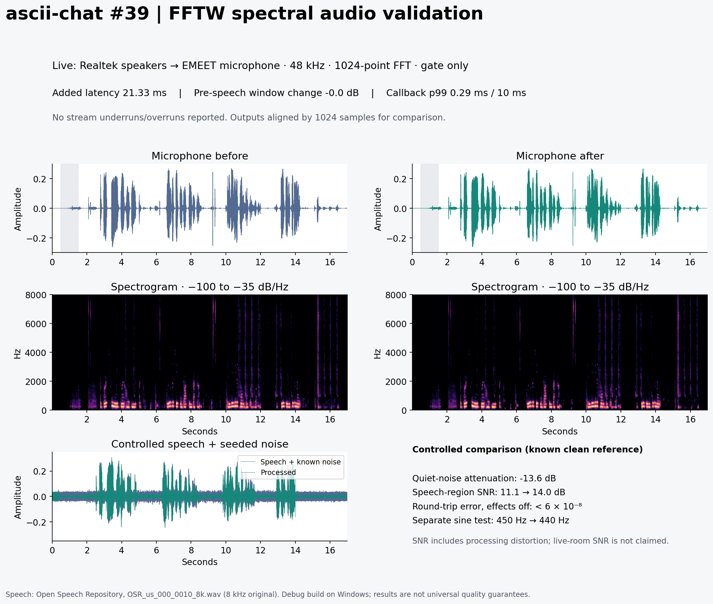
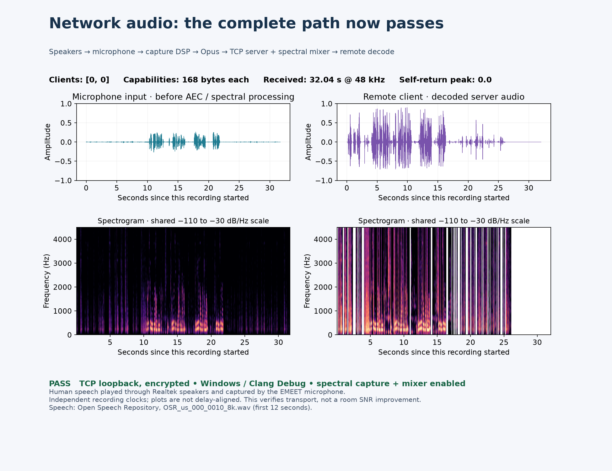
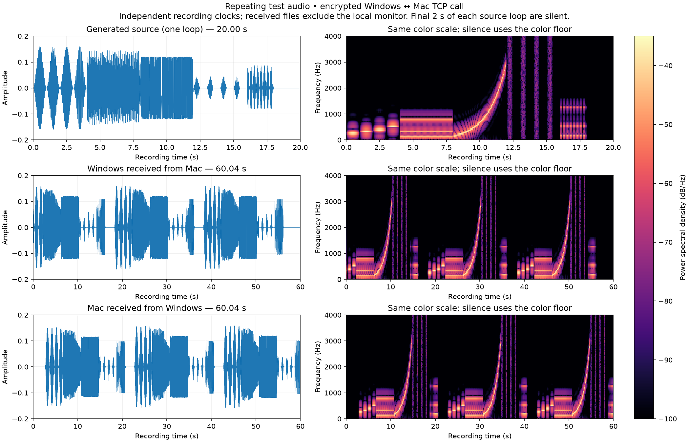

# Issue 39 validation evidence

Windows Debug build, Clang 23, 48 kHz mono. These recordings use the compiled
`spectral_process` implementation from `asciichat.dll`, driven in 480-sample
PortAudio callbacks through Python sounddevice. The physical loop used Realtek
speakers and the EMEET SmartCam Nova 4K microphone. It did not traverse the network.



- [Physical microphone, before](microphone-before.wav)
- [Physical microphone, after spectral gating](microphone-after.wav)
- [Controlled speech plus noise, before](controlled-before.wav)
- [Controlled speech plus noise, after spectral gating](controlled-after.wav)
- [Clean reference speech](reference.wav)
- [Measurements](analysis.json) and [DSP tests / benchmarks](spectral-results.json)

The physical WAVs preserve the processor's 1024-sample delay. The plot and controlled
WAVs compensate for that delay. WAVs are 48 kHz, 16-bit mono. Spectrogram scales
match. The physical pre-speech window includes transients and shows effectively
no reduction; no live-room SNR improvement is claimed. The controlled test uses
seed 39, broadband Gaussian noise plus a 187.5 Hz hum. Its silence-window reduction
is 13.6 dB, and speech-region SNR (including processing distortion) is 11.1 to 14.0 dB.
Those are different measurements, not a general 13.6 dB speech-SNR improvement.

The physical test reported no stream overruns/underruns; p99 DSP callback time was
0.29 ms and maximum 0.91 ms for a 10 ms block. Pure-tone gating reached 18 dB.
Effects-off reconstruction error was below 6e-8 for all three FFT sizes. A separate
pitch test shifted 450 Hz to 440 Hz. Full-effects Debug benchmarks are in JSON and
include the substantially more expensive optional pitch detector.

The focused tests passed, including the real AEC3/capture chain and independent
per-recipient mixer histories.

## Native network regression

The initial `CLIENT_CAPABILITIES payload size 131072 (expected 168)` failure is
fixed. The handshake's pending packet was already payload-only; the server was
mistakenly interpreting those bytes as another wire header. The regression uses
two native clients, microphone capture with spectral processing, Opus transport,
server spectral mixing, and recording at the remote client's decoder.



- [Network microphone input](network-microphone.wav)
- [Remote decoded audio](network-received.wav)
- [Network measurements](network-results.json)
- [Unencrypted regression measurements](network-plaintext-results.json)

The initial connectivity checks received 32.02 seconds over unencrypted TCP and
32.04 seconds over encrypted TCP, with both clients exiting 0 in each run.
Those checks missed a playback gate timing bug; they did not establish continuity.
The corrected encrypted run received 32.02 seconds and both clients exited 0.
The plot and WAV files now show that corrected run. Ephemeral host identity checking was disabled only for
the encrypted test's child processes; server identity authentication was not
tested. Native build and compiled DSP/integration checks also passed again.

The clients mute local playback to prevent acoustic feedback while a separate
player sends the attributed speech to the physical speakers. The receiving
client uses remote-only capture. The test asserts clean exits, two valid 168-byte
capability packets, at least 25 seconds of finite nonzero received audio, and
silence returned to the original sender (self exclusion).
The chart uses independent recording clocks; it is not delay-aligned and does
not claim an SNR improvement. WAV exports are 48 kHz, 16-bit mono.

### Playback continuity correction

The earlier received spectrogram contained white stripes because exact-zero power
became negative infinity in the plot. These represented real hard-muted audio
blocks, not absent WAV samples. Playback gate attack/release values intended as
1/50 milliseconds were passed as 1/50 nanoseconds, making transitions immediate.
The fix uses explicit nanosecond units. A compiled Opus playback regression failed
before the fix (gain exactly zero) and now verifies a smooth 50 ms release.

In the same 5–17 second inspection window, the old recording had five zero runs
of at least 20 ms (longest 280 ms; 6.33% exact-zero samples); the corrected recording
has none. See [continuity measurements](playback-continuity.json). These are separate
physical recordings of the same speech fixture, not a sample-identical SNR test.
The network regression now checks this window for hard-muted blocks. The plot also
maps zero power to the bottom of its color scale instead of rendering it white.

The successful regression uses warning-level client logs and info-level server
logs. An exploratory run with verbose client logging stalled during audio startup;
that separate logging/startup issue is not fixed here. Raw video was selected to
avoid unavailable hardware HEVC encoding; shutdown still logs an unused HEVC
encoder flush error despite successful client exits. Tests are local Windows TCP,
not WAN/WebRTC or other-platform validation.

Speech attribution: **Open Speech Repository**, file
[OSR_us_000_0010_8k.wav](https://www.voiptroubleshooter.com/open_speech/american/OSR_us_000_0010_8k.wav),
first 12 seconds, resampled from the original 8 kHz recording. The repository
[permits copying and publishing before/after examples with attribution](https://www.voiptroubleshooter.com/open_speech/index.html).
The controlled reference uses polyphase resampling; physical speaker playback uses
linear interpolation. Reproduction scripts are in `tests/audio/`.

### Generated test audio: Windows and Mac

`--test-audio` generates a repeating 20-second signal and plays it locally while
sending it to peers. The phrase includes notes, a chord, a sweep, noise bursts,
modulated harmonics, and a deliberate two-second rest. No microphone is opened.



[Source loop](test-audio-source.wav) · [Windows received from Mac](test-audio-windows-received.wav) · [Mac received from Windows](test-audio-mac-received.wav) · [Measurements](test-audio-results.json) · [Call validation](test-audio-call.json)

Native Debug builds passed on Windows and Intel macOS with Clang/Ninja. The
one-minute encrypted TCP call through SSH reverse forwarding completed with
both clients exiting 0. Both peer-only received recordings contain 60.04 seconds
of audio. Neither client logged an output underrun or capture queue overflow in
that run. The user confirmed the pattern was audible from both computers.
The 48 kHz mono WAVs above are PCM16 exports of the received float recordings;
measurements are calculated from those exports. Local monitoring is excluded
from these receive recordings. The clocks are independent; the Mac started first.

One earlier attempt disconnected after about six seconds (Mac exit 40). Its
cause remains unconfirmed; the successful retry used info-level server logging.
This validates a completed call, not a claim that intermittent networking failures
are fixed. Ephemeral host identity checking was disabled only in test child
processes. Raw video was used; existing unused HEVC shutdown errors remain.

The generated-source tests pass for 44.1/48 kHz, buffer boundaries, loop identity,
peak/RMS bounds, sweep frequency, and deliberate silence. Compiled capture/mixer
and playback-gate integration tests pass on Windows. Standalone mirror mode was
also smoke-tested. The synthetic source bypasses microphone/AEC processing.

Reproduce with a server on Windows and an SSH reverse forward to the Mac:

```sh
ascii-chat --log-level info server 127.0.0.1 --port 54389 --audio-spectral=true --status-screen=false
ssh -R 54391:127.0.0.1:54389 loomen@zachbook-pro
# In that SSH shell, start the Mac client:
ascii-chat --log-level warn client 127.0.0.1:54391 --test-pattern 0 --video-codec raw --test-audio --audio-spectral=true --speakers-volume 0.5 --snapshot --snapshot-delay 60 --width 40 --height 12 --splash-screen=false
# In a separate Windows shell, start the Windows client:
ascii-chat --log-level warn client 127.0.0.1:54389 --test-pattern 0 --video-codec raw --test-audio --audio-spectral=true --speakers-volume 0.5 --snapshot --snapshot-delay 60 --width 40 --height 12 --splash-screen=false
```

Set `ASCIICHAT_DUMP_AUDIO=1` in each client's environment to capture received
WAVs (`audio_playback_received.wav` in the platform temporary directory). Select
speaker indices for the machine as needed; Windows used Realtek device 6 and the
Mac used its default builtin speakers. To regenerate the chart:

```sh
python tests/audio/analyze_test_audio.py --source docs/evidence/issue-39/test-audio-source.wav --windows-received docs/evidence/issue-39/test-audio-windows-received.wav --mac-received docs/evidence/issue-39/test-audio-mac-received.wav --output docs/evidence/issue-39
```
