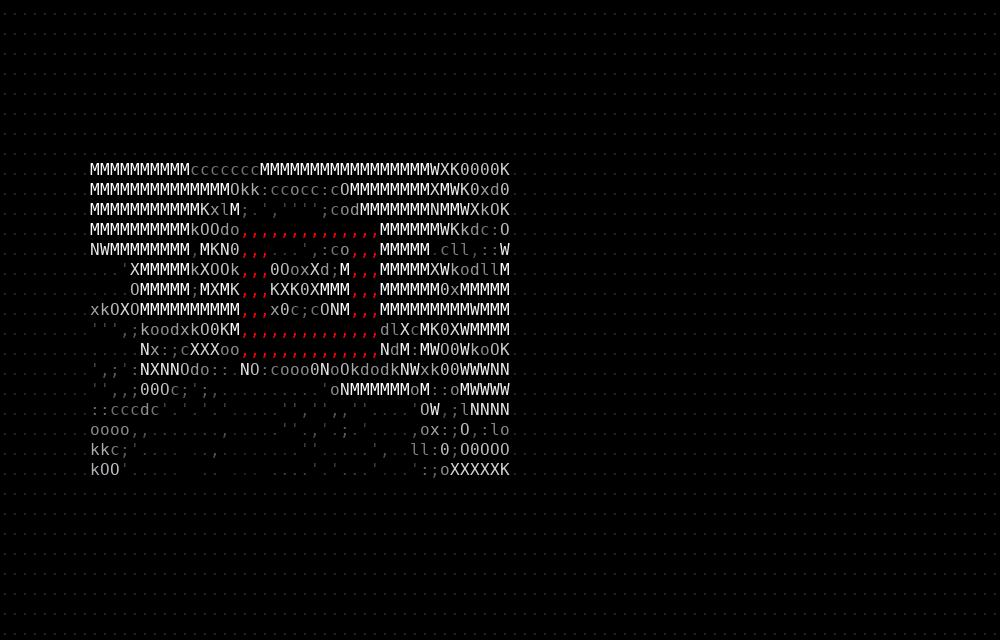
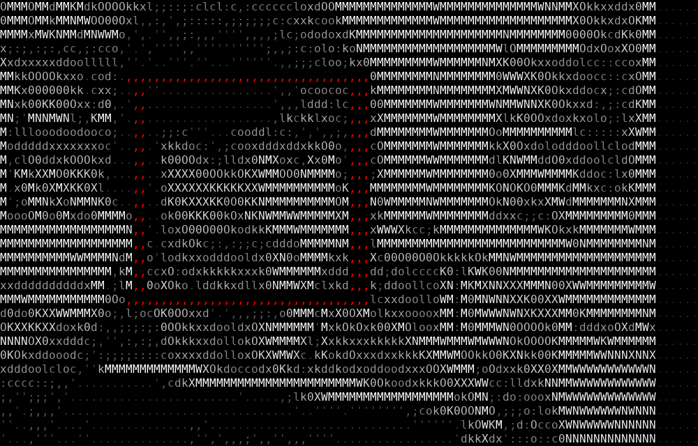
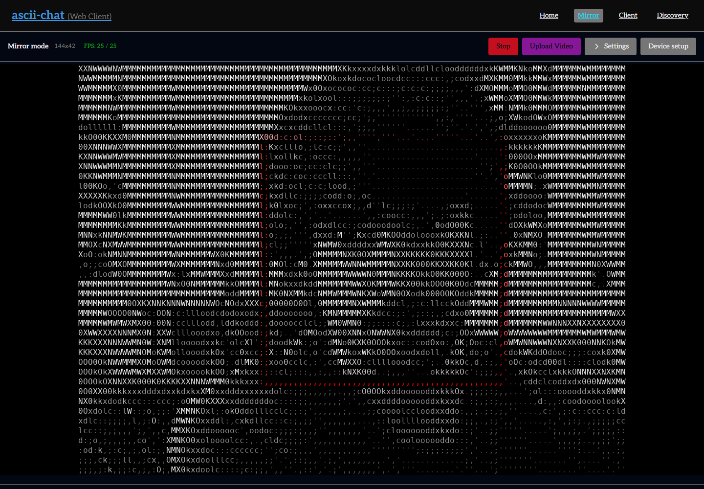
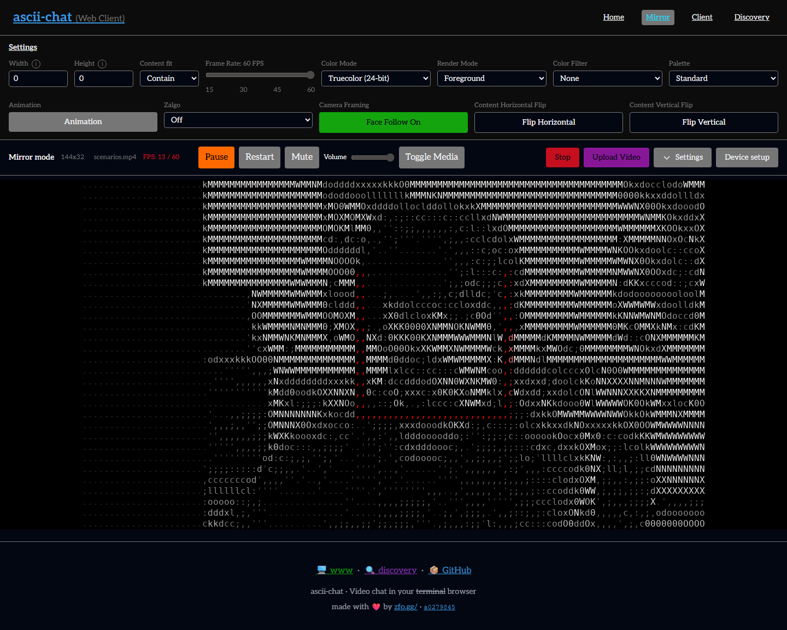
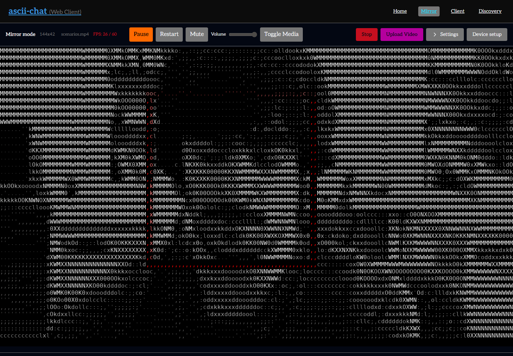
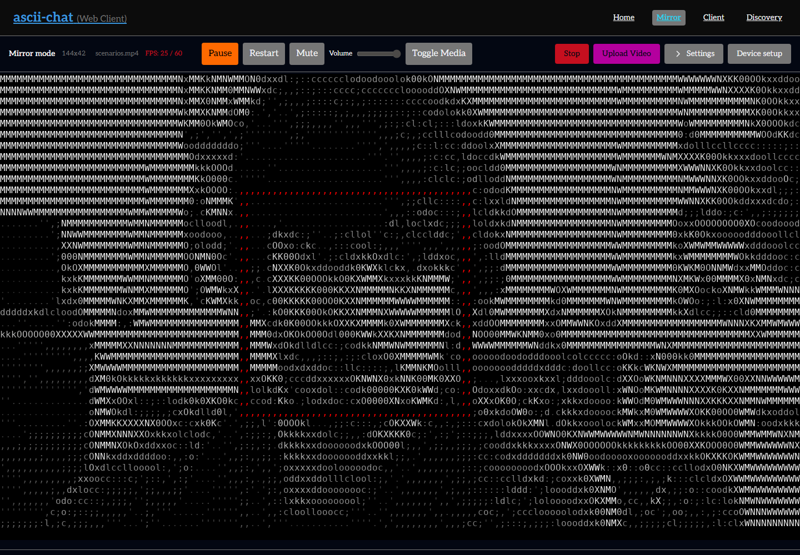
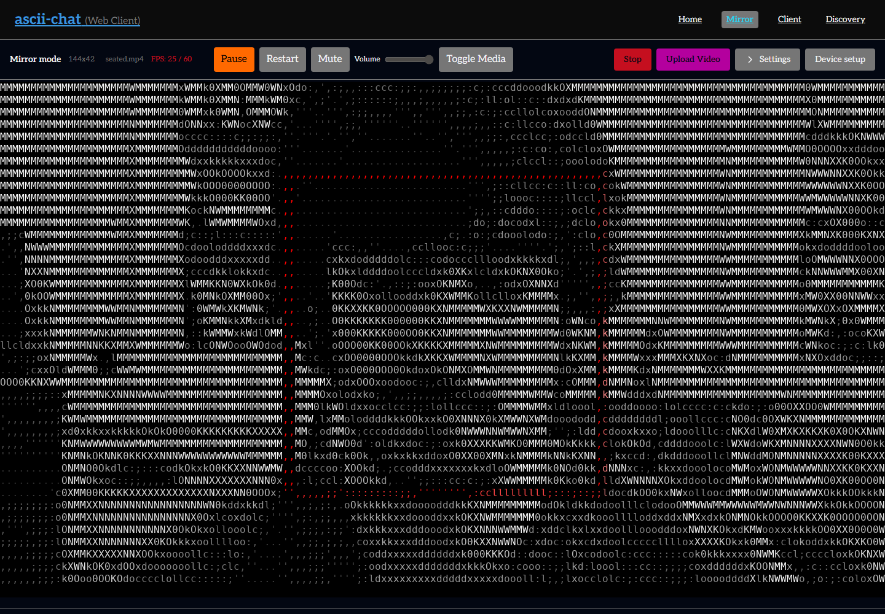
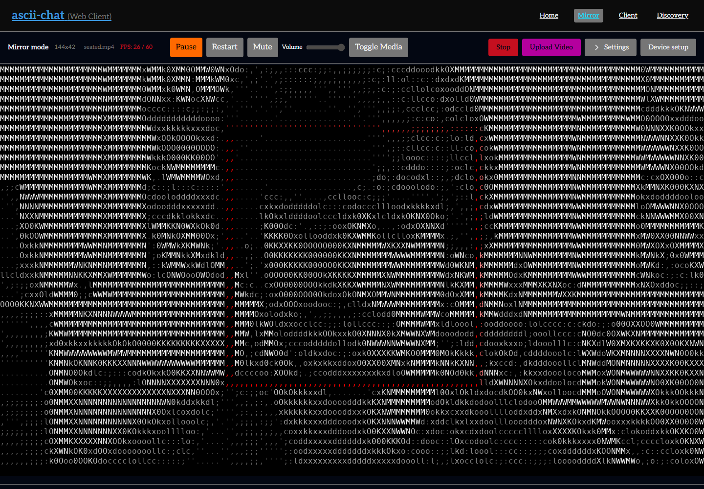

# Face Follow verification

The screenshots use OpenCV's public [faceocc2 moving-face clip](https://github.com/opencv/opencv_extra/blob/5.x/testdata/cv/tracking/faceocc2/data/faceocc2.webm),
downloaded and composed by `tests/scripts/create_face_follow_fixture.py`.
The generated sequence moves the original face, adds a larger second face from
4–9 seconds, removes both from 9–13 seconds, then restores the original face.
The original clip also feeds Chromium's camera device in both capture paths.
The video itself is not redistributed here.

## CLI

Both images were captured by the Windows Clang debug binary, using the same
640×360 scenario and a 100×32 terminal. Debug outlines are enabled in both.

| Full frame | Face Follow |
| --- | --- |
|  |  |

```powershell
build/bin/ascii-chat.exe --log-level warn --log-file artifacts/face-follow/native.log mirror --file artifacts/face-follow/scenarios.mp4 --face-follow --face-follow-debug --snapshot --snapshot-delay 3 --width 100 --height 32 --color-mode truecolor --splash-screen=false --audio-capture-source media --render-file artifacts/face-follow/native-follow.png
```

Remove `--face-follow` for the full-frame comparison. Both commands exited 0.
The debug build emits the existing unsigned font-hash overflow diagnostic in
`lib/media/render/terminal.c` with or without Face Follow.

## Browser

The Chromium integration tests exercise the real WASM detector and shared C
controller. Camera tests intercept the actual `drawImage` source rectangle,
checking that cropping occurs before ASCII conversion and preserves camera aspect
ratio. The scenarios additionally check horizontal panning, subject retention,
full-frame fallback, reacquisition, bounded time-based pan/zoom speeds, settings
toggle behavior, bare query flags, and reload persistence.










`measurements.json` records camera crop/source-draw coordinates, controller tick
counts and maximum observed speeds, blank-frame samples, and input checksums.
These are functional checks on a moving-face fixture, not a detector accuracy
benchmark or a performance guarantee for every camera and machine.

## Seated stability regression

The seated fixture translates a real face image by ±25 pixels horizontally and
±12 pixels vertically, adds a 350 ms lean, then makes a sustained 65-pixel move.
The real-detector browser run recorded zero changes to crop X, Y, or width in
46 samples during the seated shifts and brief lean. The deliberate move began
reframing after about 1.12 seconds, including detection and rendering cadence.





Five controller regressions fail against the previous controller and pass with
the anchor, quiet zone, and grace periods. These cover position/size noise,
brief leans, deliberate movement, zoom grace, and reversing detector-box noise.

## Checks

- Windows native Clang/Ninja build and CLI render: exit 0.
- All three Emscripten targets built; verified six-file JS/WASM artifact manifest.
- Linux Clang/Criterion controller suite: 11 passed, exit 0.
- Web unit suite: 347 passed in 50 files, exit 0.
- Chromium browser integration suite: 5 passed, exit 0.
- TypeScript check and production browser build: exit 0.
- `vp check`: exit 0, with three pre-existing shared renderer warnings.

The camera crop policy intentionally makes the face occupy about two thirds of
the output height. The earlier head-and-shoulders margins only produced about
1.1× zoom for this normal webcam face and failed the camera regression test.
