# Connection ownership and execution

`network_connection_t` owns a transport, framing state, deadlines, and connection
security storage. `network_server_t` owns listeners, accepted connections, and
their execution workers. Media servers, ACDS, and native session hosts supply
application callbacks through the same interface.

```mermaid
stateDiagram-v2
  [*] --> Negotiating: accept or dial
  Negotiating --> Ready: protocol negotiation succeeds
  Negotiating --> Closing: rejection, deadline, or startup failure
  Ready --> Closing: disconnect, protocol error, or requested stop
  Closing --> Closing: producer join fails; retain dependencies
  Closing --> Closed: producers and transport callbacks have drained
  Closed --> [*]
```

TCP uses the platform event loop. WebSocket and WebRTC keep their respective
library event engines. Backend adapters deliver input to the common connection
executor; modes do not accept sockets, run transport receive loops, or maintain
synthetic TCP registry entries for other transports.

`network_connection_open()` resolves and establishes an outbound endpoint.
`network_connection_run()` drives packet callbacks on its controlling worker.
An established authenticated peer can be adopted by a server or an outbound
owner without repeating the peer's cryptographic negotiation.

## Application callbacks

| Callback | Ownership contract |
| --- | --- |
| `open` | Allocate application state and attach it to the connection. A failure still enters teardown. |
| `packet` | Borrow the decoded payload until return. Return a terminal protocol/application error to close. |
| `closing` | Stop and join application producers before transport destruction. Must permit retry after a failed join. |
| `closed` | Release application state after transport callbacks have drained. Called once. |

Hooks for one connection execute serially, outside backend event loops. A failed
join retains the connection, transport, application state, and owning server so
shutdown can retry safely. Owners must join their execution worker before
destroying an outbound connection.

Registry visits snapshot and pin connections under the registry mutex, then
invoke callbacks after releasing it. Connection teardown removes the registry
entry and waits for existing visitors before releasing application state. A
visitor may request a stop; it must not synchronously destroy its pinned owner.

## Protocol and media behavior

The media and discovery negotiation profiles preserve their existing wire
protocols. They share execution, admission, deadlines, and teardown. Transport
security and authenticated peer adoption remain explicit inputs to negotiation;
neither replaces required password or identity authentication.

Discovery participants use the same media path after either TCP establishment or
authenticated WebRTC adoption. Initial capabilities precede stream startup for
both; there is no separate client-join announcement or TCP-only wait loop.

Server render workers submit media directly to the ACIP outbound scheduler.
That scheduler owns congestion admission, ordered control traffic, media dropping,
and encryption sequencing for every transport. There is no second mode-owned
audio queue, video send buffer, or transport send thread.

## Windows validation

`test-network-connections` exercises TCP, WebSocket, and local WebRTC callbacks, pinned registry
visits, rejected startup, handshake and partial-packet deadlines, malformed input,
and retained cleanup after a failed producer join. The other standalone suites
cover participant ownership, peer readiness, security policy, backend events, and
congestion.

The media server allocates slots and buffers only after security negotiation and
initial capabilities succeed. Unauthenticated stalled peers consume a bounded
connection entry rather than a media slot.

The media server sends `SERVER_STATE` when security becomes ready, before waiting
for capabilities. Browser discovery uses that announcement to begin application
setup; it must not depend on allocating a media slot first.

`tests/integration/network_fps_windows.py` uses real native servers and ConPTY
clients. It measures the CLI presentation counter over a sustained interval for
TCP, WebSocket, and WebRTC, retaining commands, logs, terminal output, and JSON
samples. A connected socket or render-loop log is insufficient to pass.

`web/web/playwright.networking.config.ts` starts an isolated web server and runs
`unified-networking.spec.ts` against native processes built from this checkout.
The browser checks advancing rendered frames and disconnect/reconnect behavior,
with screenshots and traces retained as evidence.
