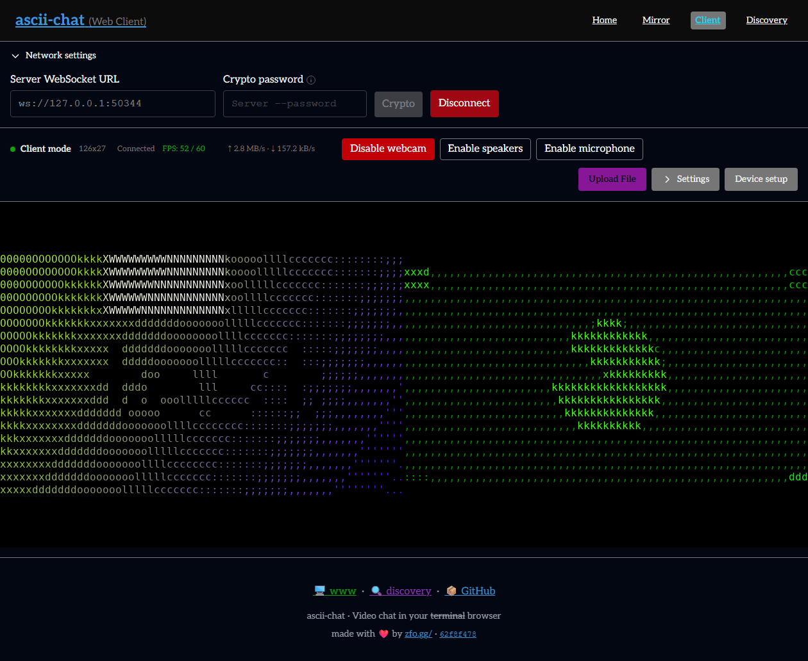
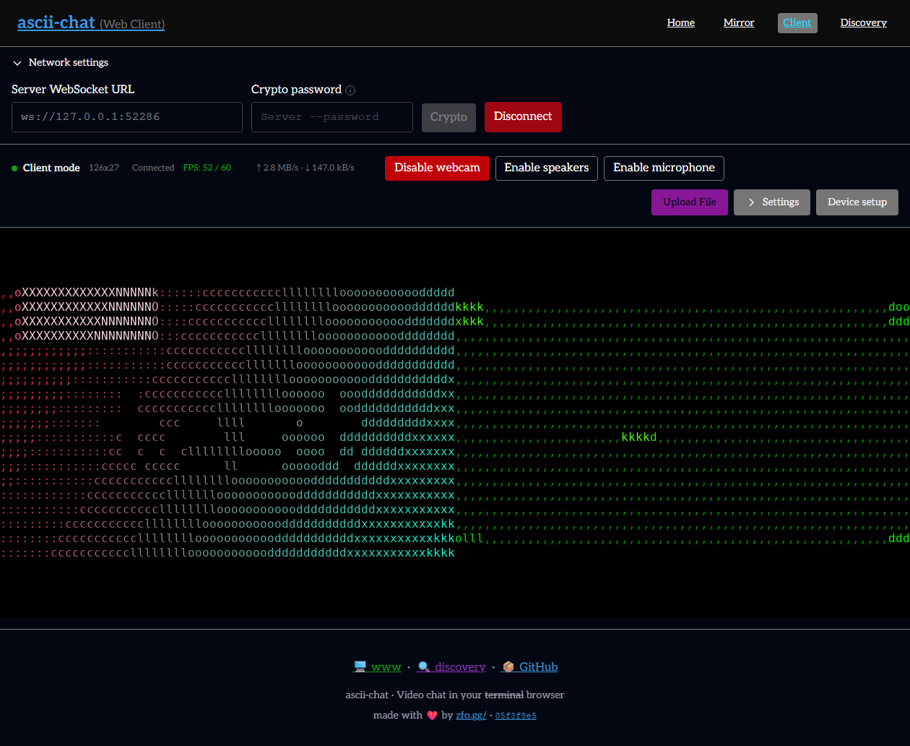
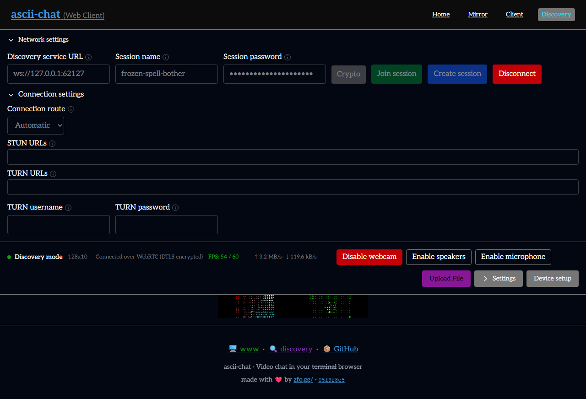

# PR 531: merge and review follow-up verification

Correction: the original case labeled `discovery-tcp` below did not disable
automatic WebRTC selection. A later reproduction selected WebRTC, so those
historical rows do not establish TCP-specific stability. The follow-up harness
forces `--no-webrtc`, exposes the fixture's host endpoint, and verifies the
accepted media transport. Original measurements remain preserved as recorded.

The native runtime cohort below was captured before the final compiler CI repairs:
an explicit buffer header, a namespaced static face-follow helper, linked dependency
feature probes, and migration of stale Criterion fixture fields. Its original
binary hashes remain preserved. [post-ci-repairs.json](post-ci-repairs.json) records
the rebuilt final Debug/Release artifacts and repeated native/browser checks.
The final browser recheck also exposed a capture callback racing disconnect;
browser callbacks now check the live session state and ownership before sending.
This browser-only correction does not change the native FPS/congestion cohort.

These runs use rebuilt binaries after merging current master and addressing all
three review threads. [results.json](results.json) records commands, executable and
library hashes, per-second presentation samples, congestion metrics, and rebuilt
WASM hashes. The parent report preserves the original implementation cohort.

The changes preserve ACDS caller deadlines and cancellation through the shared
dialing API, fix the CodeQL size expression and state-machine documentation, and
unregister connection/listener/transport diagnostics before freeing their owners.
The latter fixes an ASan use-after-free exposed by the updated discovery regression.
That regression now authenticates against a real shared host and keeps trust files
in an isolated temporary directory. Malformed negotiation failures remain covered.

## Native Windows

All 12 standalone suites pass under ASan/UBSan, including discovery-session-process,
network-connections, review-findings, host-render, WebRTC security, participant media,
runtime settings, peer readiness, crypto policy, event I/O, session connections,
and transport backpressure. The dialing regression covers preflight cancellation,
ACDS callback data, WebSocket upgrade timeout, and cancellation during an upgrade.

The separate real-process event, client lifecycle, server lifecycle, and live
runtime settings scripts all pass. They exercise authenticated sessions, rejected
peers, stalled peers, reconnects, all 13 injected startup failures for TCP and
WebSocket, concurrent shutdown, and changing rendering settings.

One additional event-test attempt during WASM compilation timed out after an
unauthorized-key rejection: the client did not exit within the unchanged 20-second
test deadline. Its logs and failed command are retained here. The complete event
suite then passed unchanged after compilation stopped, followed by four additional
TCP and four WebSocket unauthorized-key rejection/cleanup checks, all passing the
same deadline. The cause of that earlier intermittent timeout is unconfirmed.

Release servers and ConPTY clients stream changing video for 60 seconds per
transport after warmup. These are completed terminal presentations at 80×24,
truecolor, audio disabled, with Windows High priority for harness-owned processes.
This task's builds and browser checks finish before the benchmark starts.
The gate remains median ≥58.8 FPS, at least 90% of samples ≥57 FPS, and at least
80% of expected samples. This establishes performance for this configuration;
it does not establish normal-priority stability under host contention or Internet
NAT/TURN interoperability.

| Transport | Median FPS | Minimum–maximum | Samples | Gate |
| --- | ---: | ---: | ---: | --- |
| tcp | 60 | 0–62 | 51 | PASS |
| websocket | 60 | 19–76 | 60 | PASS |
| webrtc | 60 | 37–62 | 60 | PASS |
| discovery-tcp | 60 | 13–62 | 60 | FAIL: stability |

A prior fresh WebSocket measurement reached median 60 FPS but failed stability
(52 of 60 samples at least 57 FPS; the gate requires 54). Its failed command and
samples are preserved in the JSON. Windows reported 100% total CPU utilization
after that attempt while other applications remained active. The later complete
cohort in the table uses the same configuration and unchanged acceptance gates.
Both additional discovery-over-TCP attempts reached median 60 FPS but failed
stability. The first had 51/60 readings at least 57 FPS; the final result remains
marked FAIL in the table. These results do not establish stable 60 FPS for that
additional path under current host load. Both commands and samples are retained.

All six real congestion/recovery combinations pass: TCP/WebSocket/WebRTC ×
raw/H.264, including a healthy peer beside the congested peer.

## Browser and build regressions

All 376 web unit tests and the web format/lint/type checks pass. Fresh Emscripten
artifacts pass the real C/WASM host-render smoke. Headless Chromium verifies
`/client` over native WebSocket with resize/disconnect/reconnect, and `/discovery`
through native ACDS with authenticated WebRTC, changing canvas images, and resize.
Both page tests pass without page errors or native sanitizer failures.

- client-0: 288 rendered frames in five seconds.
- client-1: 290 rendered frames in five seconds.
- discovery: 289 rendered frames in five seconds.

The Windows FFmpeg DLL-copy regression and all four standalone UPnP build variants
also pass. ARM AEC3 architecture detection was corrected so ARM builds exclude
x86 SSE sources; ARM execution is outside this Windows validation cohort.
The Linux CI build exposed two Criterion fixtures using the removed discovery
socket field. Those fixtures now use the transport field, and native Linux
Clang 23 syntax checking passes. Full Linux CI execution is separate from the
Windows validation above.

## Final compiler repair checks

Both Windows builds succeed after the compiler repairs. All 12 native suites pass
again with ASan/UBSan. Native Linux Clang 23 accepts the Criterion fixture, the
shared connection file without PCH, and the combined face-follow/test-pattern unity
translation unit. The real dependency configuration finds `malloc` and rejects a
nonexistent API when the caller previously selected static-library probes.
This corrects libwebsockets incorrectly detecting macOS `execvpe`.

Rebuilt WASM passes the C/WASM host-render smoke and both Chromium native-session
page tests again. A pre-fix browser reconnect run failed the existing assertion
against sends after disconnect; the discovery page passed in that run. Capture
and encoder callbacks now check the current session state and ownership, with
three regression tests covering closure before React updates. All 379 web unit
tests pass, along with final formatting, lint and type checks. The final frame intervals are:

- client-0: 272 frames in five seconds.
- client-1: 296 frames in five seconds.
- discovery: 285 frames in five seconds.

An intermediate browser rerun overlapped source edits/hot reload and parallel
unit testing. Its reconnect interval produced 41 frames in five seconds and failed
the unchanged >100-frame gate; discovery passed. The final page run uses settled
source without parallel unit tests. The initial full unit run passed 378/379 tests:
Device Setup's failed-camera retry test timed out waiting for its retry button.
The final unit run uses two workers and unchanged assertions. These unsuccessful
attempts are recorded in `post-ci-repairs.json` alongside the final results.

Windows source-built release CI still fails at BearSSL configuration, as it also
does on [master ef5ce2c1a](https://github.com/zfogg/ascii-chat/actions/runs/39338174856/job/118352806499).
The [PR job](https://github.com/zfogg/ascii-chat/actions/runs/39341603212/job/118364220245)
fails at the same dependency step. Local Windows validation uses dynamic
dependencies and does not establish successful source-built release packaging.

The [Linux functional CI job](https://github.com/zfogg/ascii-chat/actions/runs/39346833480/job/118381352960)
stops during configuration at `cmake/deps/Opus.cmake:71`, unable to locate
`opus.h`. That module is unchanged from master; this job does not execute the
functional tests. Other fresh CI jobs were still running at report time. Local
Windows checks and targeted Linux compile/probe checks do not establish a green
cross-platform CI matrix.
