# Zalgo terminal effect

`--zalgo` decorates the displayed video with Unicode combining marks. It is
available in mirror, client, and discovery modes. Omit the option to disable it.

```sh
ascii-chat mirror --test-pattern --zalgo
ascii-chat mirror --zalgo=1
ascii-chat mirror --webcam-index 1 --zalgo=10
```

Bare `--zalgo` uses intensity 3. Both `--zalgo=7` and `--zalgo 7` select an
explicit intensity. Values must be integers from 1 to 10. A following session
name is not consumed as the optional number. `ASCII_CHAT_ZALGO` accepts 1-10.

| Intensity | Coverage of eligible characters | Marks per affected character |
| --- | --- | --- |
| 1 | 3% | 1 |
| 2 | 6% | 1 |
| 3 | 10% | 1 |
| 4 | 18% | 1 |
| 5 | 28% | 1-2 |
| 6 | 40% | 1-3 |
| 7 | 55% | 2-4 |
| 8 | 70% | 3-5 |
| 9 | 85% | 4-7 |
| 10 | 100% | 6-10 |

Positions and mark choices remain stable between frames. Increasing intensity
adds marks without reshuffling the pattern. Only printable ASCII characters
other than spaces are decorated. Existing Unicode, spaces, colors, and control
sequences are preserved. REP compression is expanded before adding marks.

Use a UTF-8 terminal and a font with combining-mark support. On Windows, run
`chcp 65001` in the terminal before starting ascii-chat. Stacking and clipping
vary by terminal and font; high levels deliberately obscure the image.

`--utf8=true` overrides automatic detection. `--utf8=false` is incompatible
with Zalgo, including piped snapshots. If decoration would exceed the
presenter's 16 MiB frame limit (including cursor controls), the original frame
is displayed and a rate-limited warning is logged.

The effect applies locally to terminal output and text snapshots, including
`--strip-ansi` output. It does not modify network frames, logs, status screens,
or `--render-file` video exports. Half-block and other Unicode palettes retain
their original glyphs, so use `--render-mode foreground` for ASCII decoration.

## Windows Terminal captures

These are actual terminal screenshots, using a 90 by 26 foreground grid and
UTF-8 output. The webcam captures use device 1 (2K Webcam).

| Level | Test pattern | Webcam |
| --- | --- | --- |
| 1 | 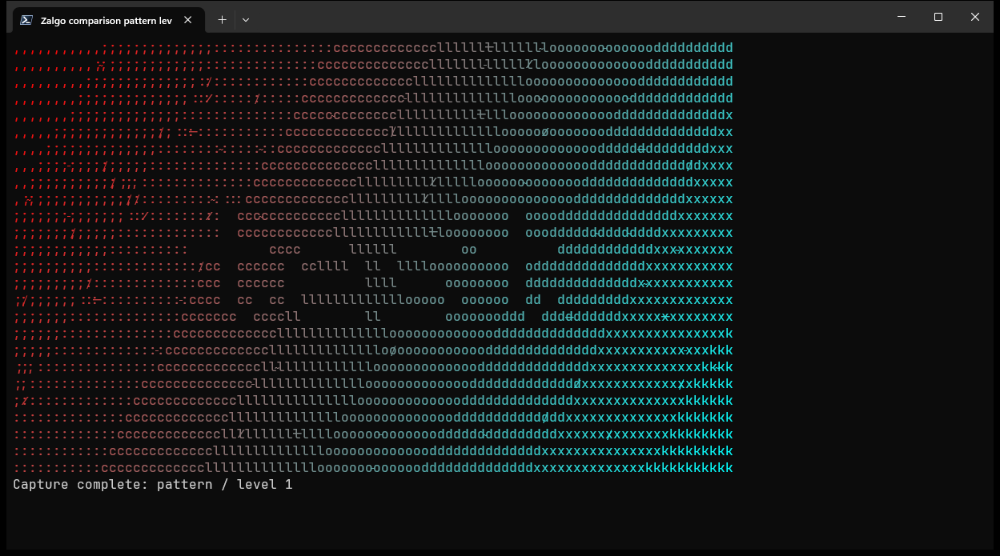 | 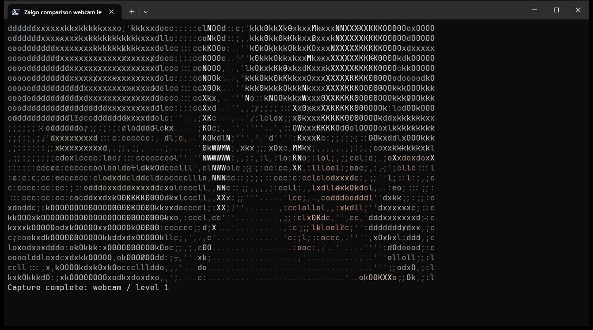 |
| 2 | 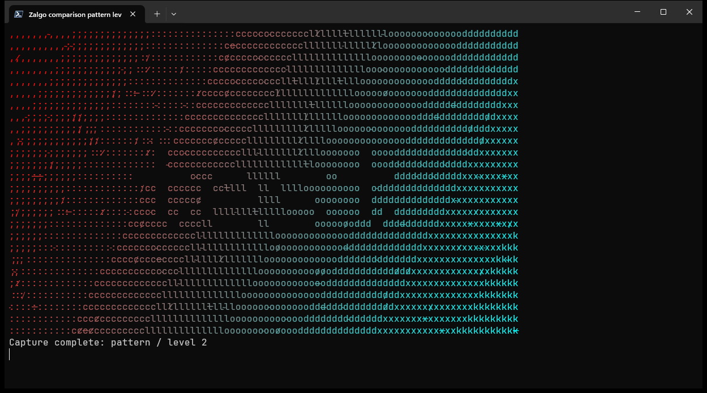 | 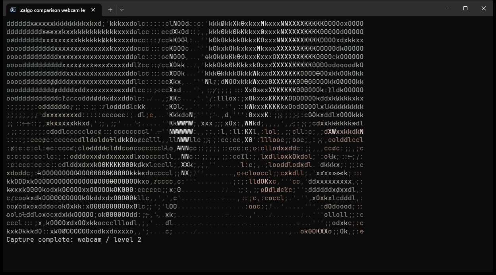 |
| 3 | 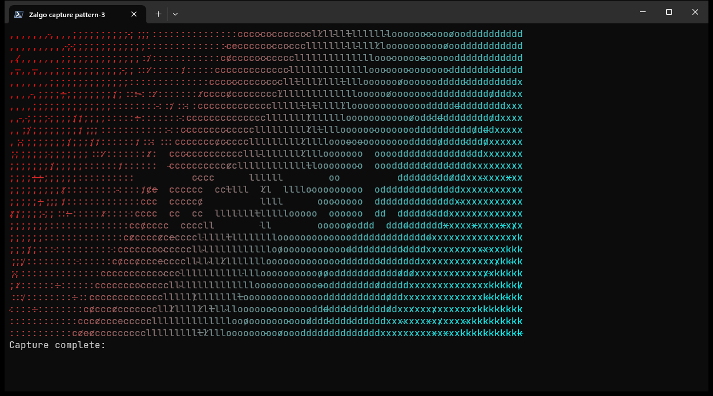 | 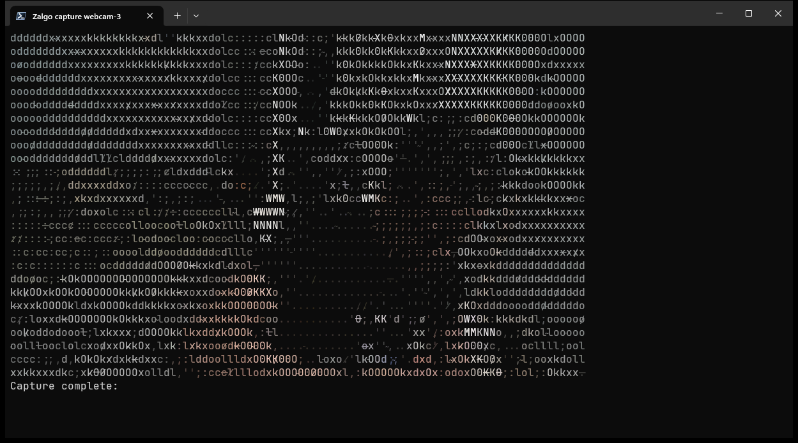 |
| 4 |  | 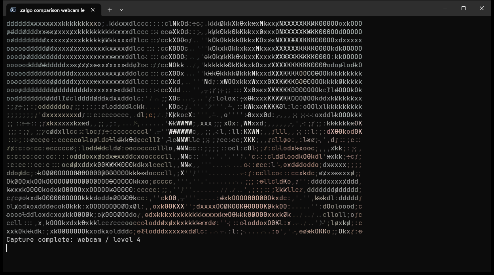 |
| 5 |  | 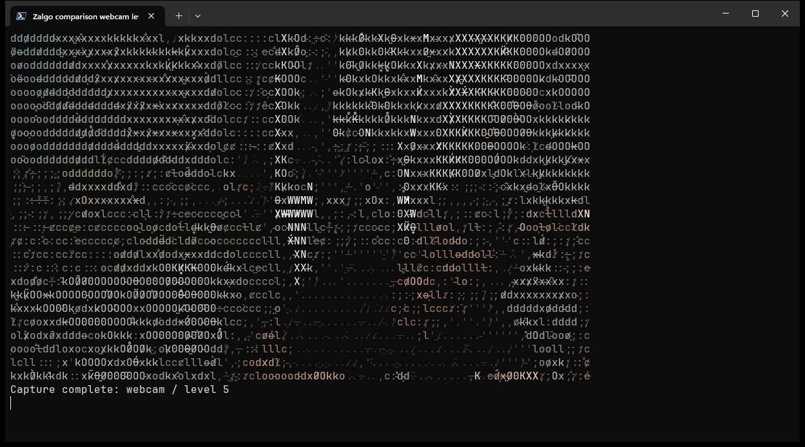 |
| 6 | 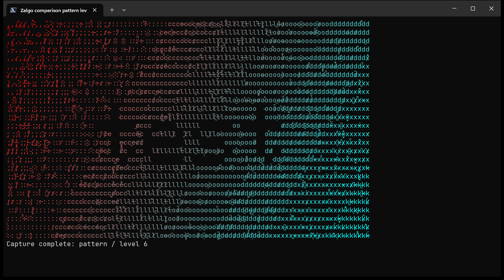 | 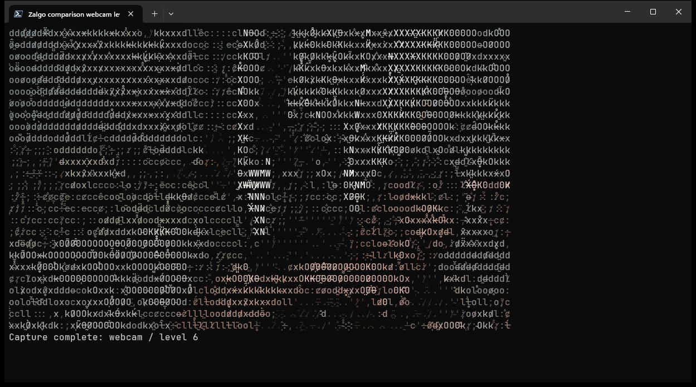 |
| 7 |  | 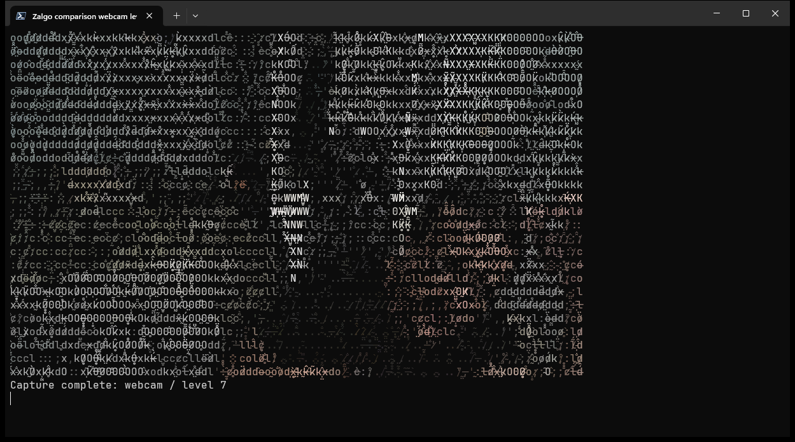 |
| 8 | 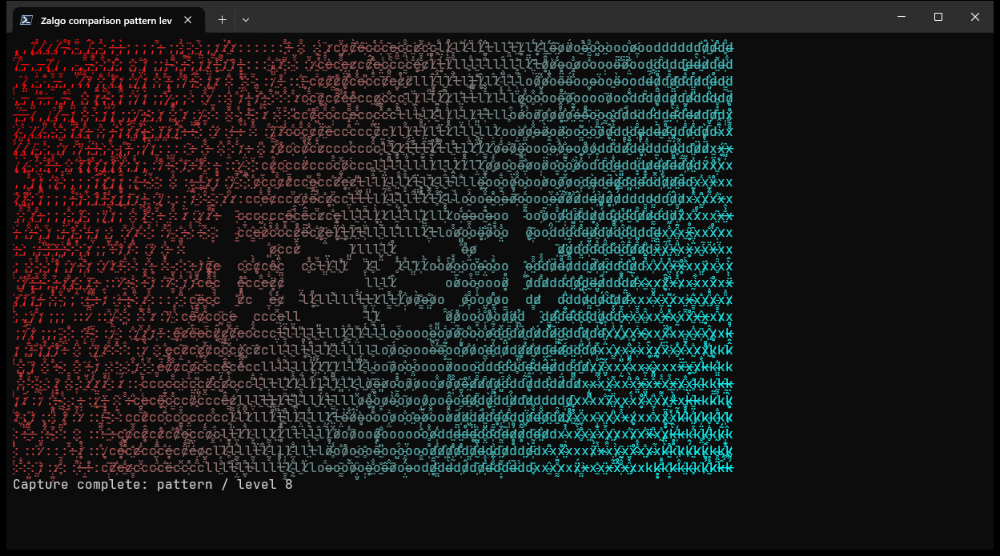 | 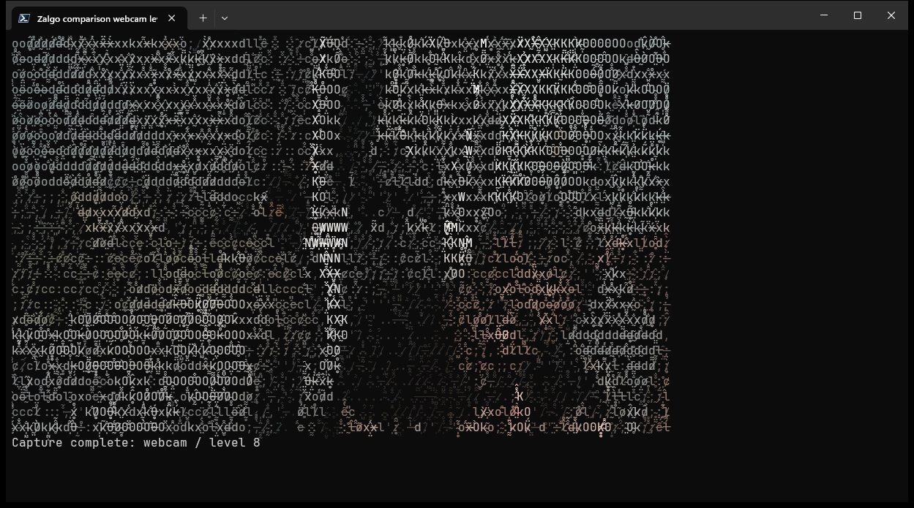 |
| 9 | 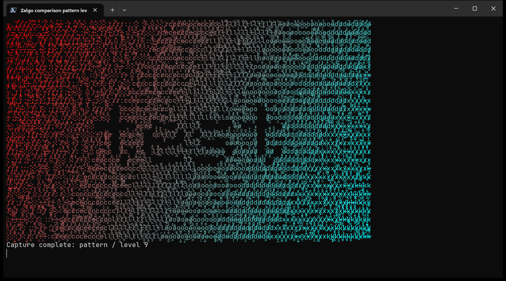 | 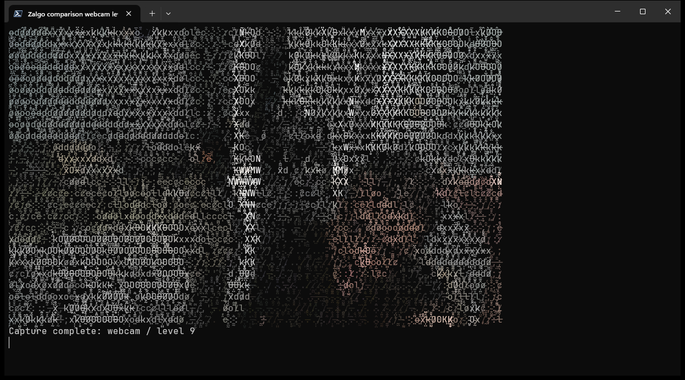 |
| 10 | 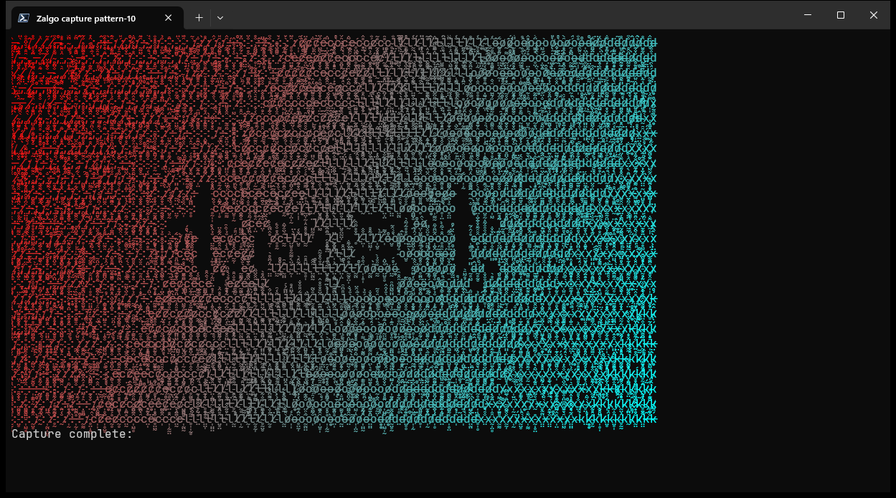 | 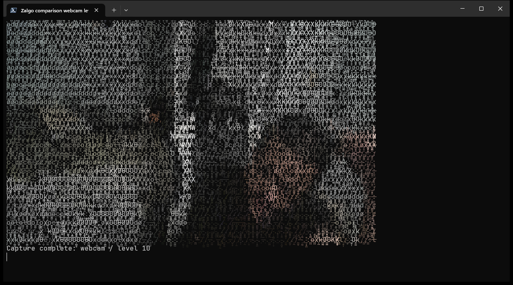 |
